# VLA Fine-tuning Notes

LIBERO のロボット操作タスクを、背景・照明・カメラ視点・物体配置・ロボット初期姿勢・センサノイズといった**摂動が加わった状態でも、周りの物体に衝突せずに**解けるようにする。
そのために、LIBERO-Plus で学習済みの VLA（Vision-Language-Action）モデル **OpenVLA-OFT（7B）** を、自前で生成したデータでファインチューニングしました。

このリポジトリには、その解説ページと、学習・推論パイプラインから抜粋したコードが入っています。

**解説ページ：https://karai-x.github.io/vla_competition/**

---

## 結果

ベースにした学習済みモデルをそのまま動かした場合と、ファインチューニング後のモデル（追加学習 計25,000更新）を、LIBERO シミュレータの**同じシナリオ・同じ評価手順**で比べました。
衝突は「操作対象以外の物体を1mm超動かしたら衝突」と定義しています。

| 評価セット（30タスク・各100件） | タスク成功率<br>なし → 後 | 衝突なし成功率<br>なし → 後 |
| --- | ---: | ---: |
| 背景・照明の摂動 | 90% → **99%** | 64% → **70%** |
| 視点・配置・初期姿勢・ノイズの摂動 | 80% → **84%** | 52% → **60%** |

対象は LIBERO の spatial / object / goal の30タスク。最大300ステップ、128px入力、8ステップ予測・8ステップ実行、評価seed固定。

---

## ベースモデル

[`Sylvest/openvla-7b-oft-finetuned-libero-plus-mixdata`](https://huggingface.co/Sylvest/openvla-7b-oft-finetuned-libero-plus-mixdata)（revision `a85655ec941bae6644c9fbdf62db02b9726d7cf5`）。次の3段階で作られたモデルです。

1. **[OpenVLA](https://openvla.github.io/)**：視覚言語モデル Prismatic-7B を土台にした 7B の VLA。言語モデルは **Llama 2 7B**、画像エンコーダは **DINOv2** と **SigLIP** の特徴を連結して使い、MLP プロジェクタで Llama 2 の入力に変換します。Open X-Embodiment の約97万軌道で、Actionを各次元256段階の離散トークンとして1つずつ出力するように学習されています。
2. **[OpenVLA-OFT](https://openvla-oft.github.io/)**：Actionの出し方をロボット向けに作り直したファインチューニング手法。正面と手首の画像2枚と proprio を入力に加え、**8ステップ分の連続値Actionを1回の推論で並列に**出力し、L1 回帰で学習します。LIBERO の4タスク群を1つのモデルで学習しています。
3. **[LIBERO-Plus](https://arxiv.org/abs/2510.13626) で追加学習**：背景・照明・カメラ視点・言語の言い換え・センサノイズ・妨害物などを変えたデモで、2 のモデルをさらに学習したもの（モデル名の「OFT+」はこれを指す）。

このベースはすでに摂動に強い一方、**ロボット初期姿勢の変化**、**周りの物体との接触**、**新しい物体の追加や大きな配置変更**は学習の対象になっていませんでした。
今回のファインチューニングでは、これらを補うデータを作りました。LoRA（rank 32）・Action head・proprio projector を学習し、直前3 Actionの履歴入力も追加しています。

---

## データ

LIBERO シミュレータの中で摂動を加えた初期状態を作り、そこから**成功し、かつ非対象物体を動かさない**軌道だけを教師として採用しました。

| 枠 | エピソード | 抽出比率 | 中身 |
| --- | ---: | ---: | --- |
| 標準LIBERO成功デモ | 1,040 | 30% | 30タスクの公開デモ。同じ初期状態のまま軌道を短縮・平滑化した改善版を含む |
| 独自生成＋画像変動 | 1,148 | 40% | 物体の分散配置と新規物体、ロボット初期姿勢、カメラ視点、照明、ノイズ5方式の摂動を加えて生成 |
| robustness / recovery | 3,642 | 30% | 公開データセット（失敗からの復帰を含む）と、摂動を加えた独自の復帰軌道480本 |
| **合計** | **5,830** | 100% | validation / test はエピソード単位で分離 |

生成した摂動の例（学習データの最初のフレーム、左が変更前・右が変更後）：

| 物体の分散配置＋新規物体 | ロボット初期姿勢（手首カメラ） | カメラ視点 | 照明 |
| :---: | :---: | :---: | :---: |
| 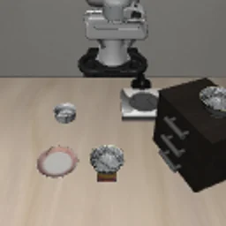 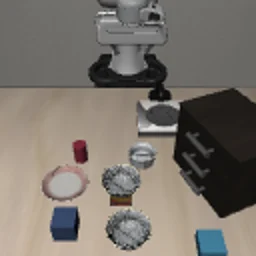 | 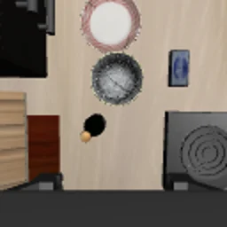 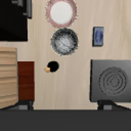 | 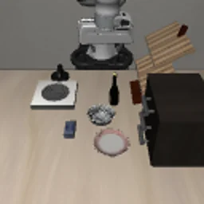 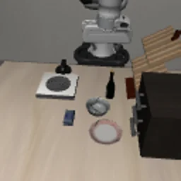 | 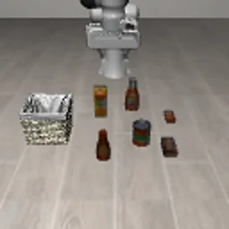 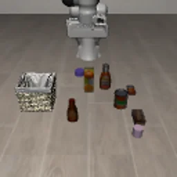 |

| motion blur | gaussian blur | zoom blur | fog | glass blur |
| :---: | :---: | :---: | :---: | :---: |
| 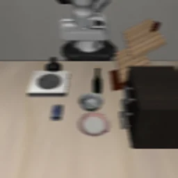 | 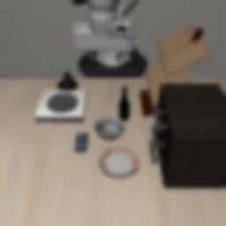 | 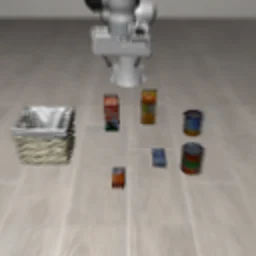 | 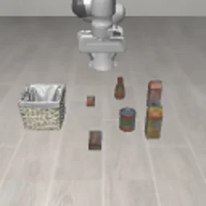 |  |

さらに、同じ初期状態のまま軌道を短縮・平滑化し、ステップ数・jerk・SPARC・経路長・回転量の**重みを各10〜30%のどこに置いても悪化しない**改変だけを採用する品質ゲートで、教師の動きを改善しています。

---

## 失敗から得た知見

解説ページでは、各項目を「観測」と「判断」に分けて書いています。

1. まずファインチューニングなしのモデルで、成功率が出ることを確かめる
2. gripperの符号とloss maskは、ファイルにあるだけでは効いていない
3. 強いモデルへの追加学習は、学習率が既存能力の保持を決める
4. 平均L1が良くなっても、動きは「縮んで」いる
5. ほぼ同じ入力に異なる教師があると、L1 headは中間を出す
6. 衝突フラグの原因は、受動的な再生で確かめる
7. validation lossの上昇は、成功率の低下を意味しない（逆も）
8. 主要な変更は1回に1つ。悪化した実験も消さない

---

## リポジトリ構成

```
.
├── portfolio/                    解説ページ（静的HTML。GitHub Pagesで公開）
│   ├── index.html / app.css / app.js
│   └── materials/                図と摂動の画像（webp）
├── src/parc2026/
│   ├── policy/openvla_oft/       推論側：画像前処理、Action chunk実行、Action履歴、正規化統計の受け渡し
│   ├── training/                 学習側：mask付きL1と符号付きバイアス損失
│   └── evaluation/               5指標の計測、SPARC、重み範囲つき品質スコア、軌道品質ゲート
├── configs/
│   └── parc_proxy_score_v1.json  品質スコアの仮定（重み・基準コスト）
├── tests/                        上記モジュールの単体テスト
└── .github/workflows/            Pages公開とテスト
```

| ファイル | 内容 |
| --- | --- |
| `policy/openvla_oft/preprocessing.py` | LIBEROカメラ画像の180°回転とリサイズ。学習ローダと推論サーバで共有する唯一の前処理 |
| `policy/openvla_oft/action_execution.py` | 8ステップ予測のうち先頭k本だけ実行して再観測するラッパ |
| `policy/openvla_oft/action_history.py` | 直前3 Actionの履歴を、ゼロ初期化した分岐でproprioトークンへ加算（元のモデルの出力を変えずに拡張） |
| `policy/openvla_oft/normalization_binding.py` | LoRAで包んだモデルの内側へ正規化統計を確実に渡す |
| `training/action_loss.py` | `action_loss_mask` 付きL1と、次元別の符号付きバイアス損失 |
| `evaluation/proxy_score.py` | ステップ数・jerk・SPARC・経路長・回転量の計測と、重み範囲つきの品質スコア |
| `evaluation/trajectory_quality_gate.py` | 各重み10〜30%の最悪ケースでも改善する軌道改変だけを採用する判定 |
| `evaluation/sparc.py` | SPARC（Balasubramanian et al., 2015）の実装 |

---

## 使い方

### テストの実行

Python 3.10 以上。

```bash
pip install -e ".[test]"          # numpy / torch / pillow / pytest
pytest
```

### 解説ページをローカルで開く

```bash
cd portfolio
python -m http.server 8000         # → http://localhost:8000/
```

`index.html` をブラウザで直接開いても表示できます。

---

## 含まないもの

学習データセット、学習済み重み、ロールアウト動画、LIBERO / LIBERO-Plus 本体と OpenVLA-OFT の学習コードは含みません。
抜粋したコードはそれらと組み合わせて使っていたもので、このリポジトリ単体で学習や評価を再現することはできません。

## 参考

- OpenVLA: <https://openvla.github.io/>
- OpenVLA-OFT: <https://openvla-oft.github.io/>
- LIBERO-Plus: <https://arxiv.org/abs/2510.13626>
- ベースモデル: <https://huggingface.co/Sylvest/openvla-7b-oft-finetuned-libero-plus-mixdata>
- 追加データ: [`argo11/openvla-oft-plus-robustness-recovery`](https://huggingface.co/datasets/argo11/openvla-oft-plus-robustness-recovery)（`v1.0.0`）
